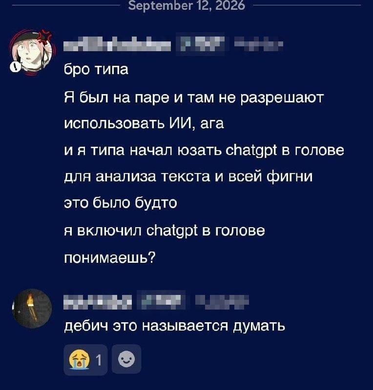

# Лабораторная работа №1

## Обо мне
- **ФИО:** Бойко Виктория Владимировна
- **Группа:** 6405-010302D
- **Научный руководитель:** Козлова Елена Сергеевна
- **Предполагаемая тема диплома:** Использование нейронных сетей для моделирования фокусировки излучения

## Цитата
> «Видишь, голубчик, я откровенно и просто скажу: всякий порядочный человек должен быть под башмаком хоть у какой-нибудь женщины.»  

– Ф.М. Достоевский

## Картинка


## Бонус: анекдот
Пригласили ветеринара, статистика и физика, чтобы каждый за 100 тысяч долларов в течение недели придумал способ для угадывания коня, который победит на скачках. Через неделю все трое приходят...

Ветеринар: Я разработал таблицу, по которой, зная физические данные коней, можно будет предсказать победителя.

Статистик: Я построил регрессию, по которой, зная предыдущие забеги, можно предсказать коня-победителя.

Физик: Мне нужно для работы ещё два года и 1 миллион долларов, но к настоящему моменту я построил модель сферического коня в вакууме.

---

# Лабораторная работа №2

## Задание
Разработать многостраничный web-сайт на произвольную тему с использованием технологий HTML и CSS.

## О сайте
Многостраничный веб-сайт **«MIND / FIELD – Природа сознания»**, представляющий собой мини-справочник по ключевым философским теориям сознания.

## Структура

```text
lab2/
├── images/
│   └── mind-orbit.png     # Картинка в проекте
├── index.html             # Главная страница
├── materialism.html       # Раздел 01: Материализм
├── dualism.html           # Раздел 02: Дуализм
├── idealism.html          # Раздел 03: Идеализм
├── panpsychism.html       # Раздел 04: Панпсихизм
└── style.css              # Общая таблица стилей
```

## Выполненные требования:
- **Структура:** 5 страниц с единой навигационной цепочкой;
- **HTML:**  блочные и строчные элементы, навигационные ссылки, изображение, таблица;
- **CSS:** отдельный подключаемый файл, >3 видов селекторов, переменные цвета;
- **Таблица:** 3 вида выравнивания текста в столбцах (влево, по центру, вправо);
- **Ограничения:** выполнено без JavaScript, Bootstrap и сторонних библиотек.

---

# Лабораторная работа №3

## Задание
Изучение основ JavaScript. Написать набор функций на языке JavaScript, реализующих требуемый функционал, и загрузить проект в репозиторий.

## О проекте
Реализация набора функций ядра JavaScript (`core.js`), покрытых unit-тестами (Mocha + assert). Проект демонстрирует работу с замыканиями, рекурсией, побитовыми операторами, генераторами последовательностей и глубоким сравнением объектов.

## Структура

```text
lab3/
├── src/
│   ├── core.js          # Реализация функций
│   └── core.spec.js     # Тесты
├── package.json         # Зависимости и скрипты
└── README.md            # Описание проекта
```

---

# Лабораторная работа №4

## Задание
Модернизация web-сайта из лабораторной работы №2 с использованием современного CSS и основ ООП на JavaScript.

## О сайте
Обновлённая версия справочника **«MIND / FIELD – Природа сознания»**: вёрстка разделена на Grid и Flexbox, все цвета вынесены в CSS-переменные, добавлена CSS-анимация, страница с формой и обработка данных на JS через класс, а классы переведены на методологию БЭМ.

## Структура

```text
lab4/
├── images/
│   └── mind-orbit.png     # Схема для главной страницы
├── index.html             # Главная страница (вёрстка на Grid + CSS-анимация)
├── materialism.html       # Раздел 01: Материализм
├── dualism.html           # Раздел 02: Дуализм
├── idealism.html          # Раздел 03: Идеализм
├── panpsychism.html       # Раздел 04: Панпсихизм
├── auth.html              # Раздел 05: Страница с формой (вёрстка на Flexbox)
├── script.js              # Класс SubscriptionRequest и валидация формы
└── style.css              # Стили по БЭМ (все цвета через CSS-переменные)
```

## Выполненные требования:
- **Flexbox и Grid:** главная страница `index.html` свёрстана на CSS Grid, страница формы `auth.html` — на Flexbox;
- **Цвета:** все цвета заданы через CSS-переменные в `:root`;
- **Анимация:** реализована CSS-анимация `@keyframes scanWave` для схемы на главной странице;
- **Форма:** на странице `auth.html` реализовано 4 типа полей (`text`, `password`, `select`, `checkbox`) и кнопка отправки, добавлена базовая валидация;
- **ООП на JS:** создан класс `SubscriptionRequest` с конструктором и методом `printFormatted()` для форматированного вывода объекта в консоль при отправке формы;
- **Бонус:** использована методология БЭМ.