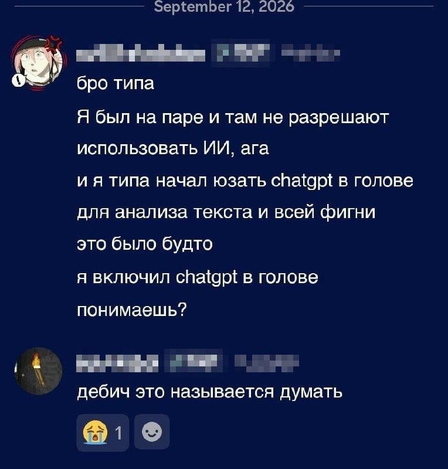

# Лабораторная работа №1

## Обо мне
- **ФИО:** Бойко Виктория Владимировна
- **Группа:** 6405-010302D
- **Научный руководитель:** Козлова Елена Сергеевна
- **Предполагаемая тема диплома:** Использование нейронных сетей для моделирования фокусировки излучения

## Цитата
> «Видишь, голубчик, я откровенно и просто скажу: всякий порядочный человек должен быть под башмаком хоть у какой-нибудь женщины.»  

– Ф.М. Достоевский

## Картинка


## Бонус: анекдот
Пригласили ветеринара, статистика и физика, чтобы каждый за 100 тысяч долларов в течение недели придумал способ для угадывания коня, который победит на скачках. Через неделю все трое приходят...

Ветеринар: Я разработал таблицу, по которой, зная физические данные коней, можно будет предсказать победителя.

Статистик: Я построил регрессию, по которой, зная предыдущие забеги, можно предсказать коня-победителя.

Физик: Мне нужно для работы ещё два года и 1 миллион долларов, но к настоящему моменту я построил модель сферического коня в вакууме.

---

# Лабораторная работа №2

## Задание
Разработать многостраничный web-сайт на произвольную тему с использованием технологий HTML и CSS.

## О сайте
Многостраничный веб-сайт **«MIND / FIELD – Природа сознания»**, представляющий собой мини-справочник по ключевым философским теориям сознания.

## Структура

```text
lab2/
├── images/
│   └── mind-orbit.png     # Картинка в проекте
├── index.html             # Главная страница
├── materialism.html       # Раздел 01: Материализм
├── dualism.html           # Раздел 02: Дуализм
├── idealism.html          # Раздел 03: Идеализм
├── panpsychism.html       # Раздел 04: Панпсихизм
└── style.css              # Общая таблица стилей
```

## Выполненные требования:
- **Структура:** 5 страниц с единой навигационной цепочкой;
- **HTML:**  блочные и строчные элементы, навигационные ссылки, изображение, таблица;
- **CSS:** отдельный подключаемый файл, >3 видов селекторов, переменные цвета;
- **Таблица:** 3 вида выравнивания текста в столбцах (влево, по центру, вправо);
- **Ограничения:** выполнено без JavaScript, Bootstrap и сторонних библиотек.